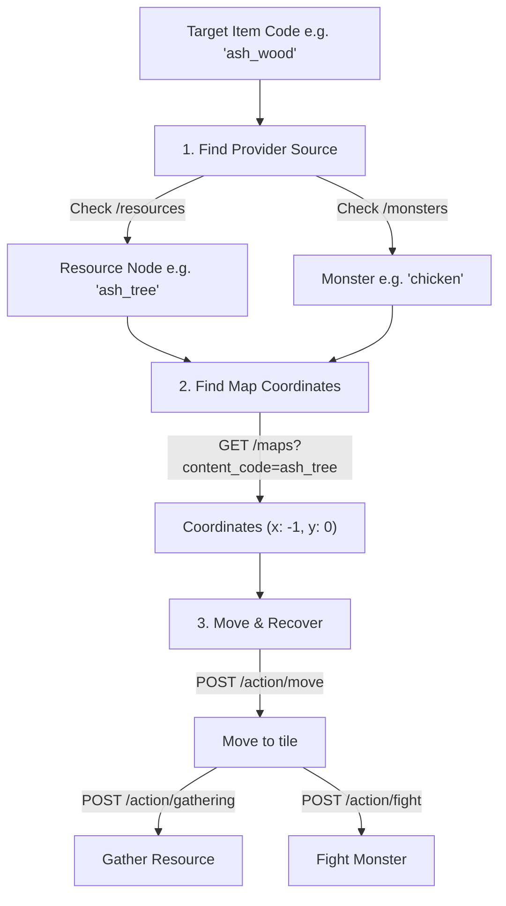
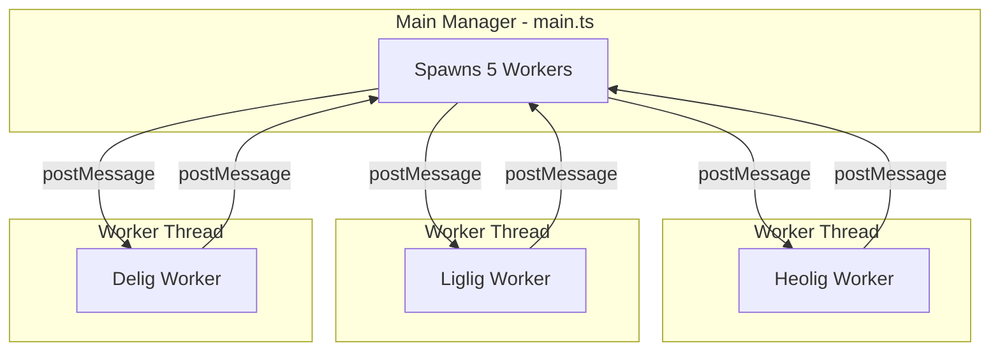

# ArtifactsMMO

This repo is a client made to play with the Artifacts API to learn and experiment with Typescript and Deno.


Artifacts is a sandbox MMORPG built for developers where every action is an API call. Move, fight, craft, trade — all through HTTP endpoints you call from any programming language. Automate your characters, build custom tools, and compete on the leaderboard.

## Running the Project

```bash
deno --env-file --allow-env --allow-net Client/main.ts
```

## Searching resources



## Workers



### Logs

Each character workers has it's own log for easier debugging

```bash
# jq : json query (formatter)
## -R: raw input
## -r: raw output
## fromjson?: avoid error in case of none json Target
## // . : display plain text
tail -f ./logs/<character_log>.log | jq -R -r 'fromjson? // .'
```
